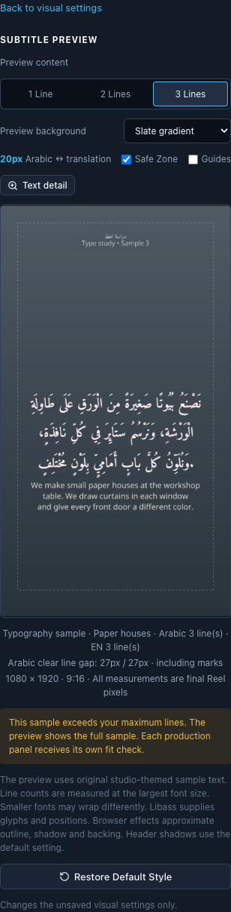
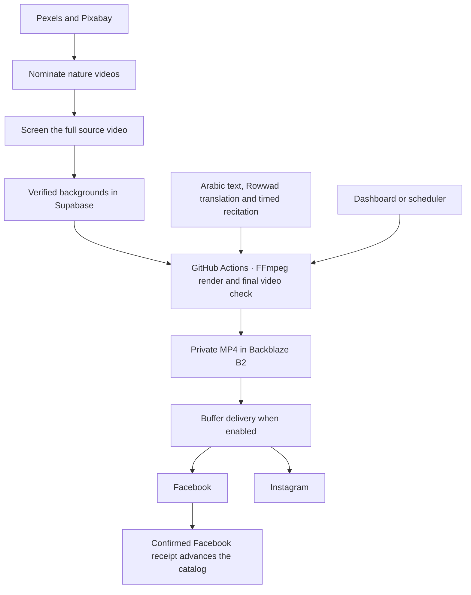

# Quran Reels Automation

Create a vertical Quran recitation video with Arabic text, a Rowwad translation and screened nature footage. Run your own Next.js dashboard to review settings and run history. A Python worker renders a 1080 × 1920 MP4 with FFmpeg and can send it to your Facebook and Instagram channels through Buffer.

## Try the subtitle preview

For this demo you only need Node.js 22 and npm. Get the source from GitHub's **Code** menu (clone or download and extract the ZIP). Open a terminal in the folder containing `apps/` and `requirements.txt`, then run:

```sh
cd apps/dashboard
npm ci
npm run dev
```

Open [the subtitle preview](http://127.0.0.1:3000/preview-qa#reel-preview). Choose **3 Lines** under **Preview content**. With the default two-line limit, the full sample stays visible and a warning appears below it. You can try the controls without a login, API keys or a database. The samples use original studio-themed text.

To try the admin dashboard next, follow [Create your first admin login](DEPLOYMENT.md#create-your-first-admin-login). You can sign in locally before connecting any services. Saving settings requires an initialized Supabase database.

<details>
<summary>See the preview on a phone</summary>



</details>

## How a Reel gets made



Discovery and qualification can run in GitHub Actions or in a local Python session on a Mac. Both use the same installation's Supabase queue. A nomination is a candidate for screening. The Reel worker selects qualified footage and checks the finished video before delivery. [Architecture](ARCHITECTURE.md)

## Run it with your own accounts

Before provisioning cloud services, confirm that you can obtain the original English Rowwad **1.0.19** reference and the permissions for your intended use. The distribution includes its verifier. Operators supply the source text and any required reviewed panel files. You can run the demo and the developer checks while arranging access.

| What you want to do | Where to start |
| --- | --- |
| Set up the dashboard and database | [Create a private installation](docs/PUBLIC_SETUP.md#create-the-private-installation), initialize your own [database](DEPLOYMENT.md#fresh-database), then save the dashboard settings with automation off. |
| Verify the Quran sources | Configure Quran Foundation, the original English Rowwad **1.0.19** reference and permission to reuse the recitation. Supply reviewed panel manifests for verses that need them. [Source setup](docs/PUBLIC_SETUP.md#english-rowwad-1019) |
| Find background videos | Run **Discover Background Candidates** and **Qualify Background Candidates** on GitHub, or use the local Python command. [Background setup](docs/PUBLIC_SETUP.md#build-a-background-pool) |
| Make the first private MP4 | On the private default branch, run **Generate Reel** with `run_kind=test`. Review the stored MP4 before enabling delivery. [First Reel walkthrough](docs/PUBLIC_SETUP.md#from-the-first-mp4-to-buffer) |
| Publish through Buffer | Check both connected channels, enable delivery in your installation and inspect each channel's result. Only confirmed Facebook publication advances the fixed catalog of 2,211 ayahs. [Publishing walkthrough](docs/PUBLIC_SETUP.md#from-the-first-mp4-to-buffer) |

Each installation supplies its own credentials, reviewed material and delivery history. Public CI exercises the software with distributable fixtures. A hosted database acceptance workflow is also available for a disposable Supabase instance. [Database checks](DEPLOYMENT.md#fresh-database)

## Run the developer checks

From the repository root, use Python 3.12, FFmpeg with libass, and Fontconfig. The CV fetch downloads three pinned OpenCV models.

```sh
python3.12 -m venv .venv
. .venv/bin/activate
python -m pip install -r requirements.txt
python scripts/fetch_fonts.py --offline
python scripts/fetch_cv_models.py
python scripts/run_python_tests.py --fail-on-skip
python scripts/check_repository_safety.py
```

From `apps/dashboard`, run `npm ci`, `npm test` and `npm run build` to check the web app.

## License and contributions

Eligible original software is distributed under the [Apache License 2.0](LICENSE). The bundled fonts and attributed editorial selection carry their own terms. [Third-party notices](THIRD_PARTY_NOTICES.md) · [Contributing](CONTRIBUTING.md) · [Security reporting](SECURITY.md)
