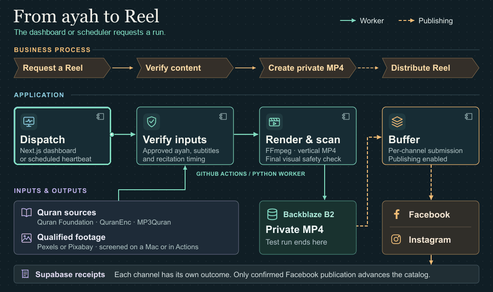
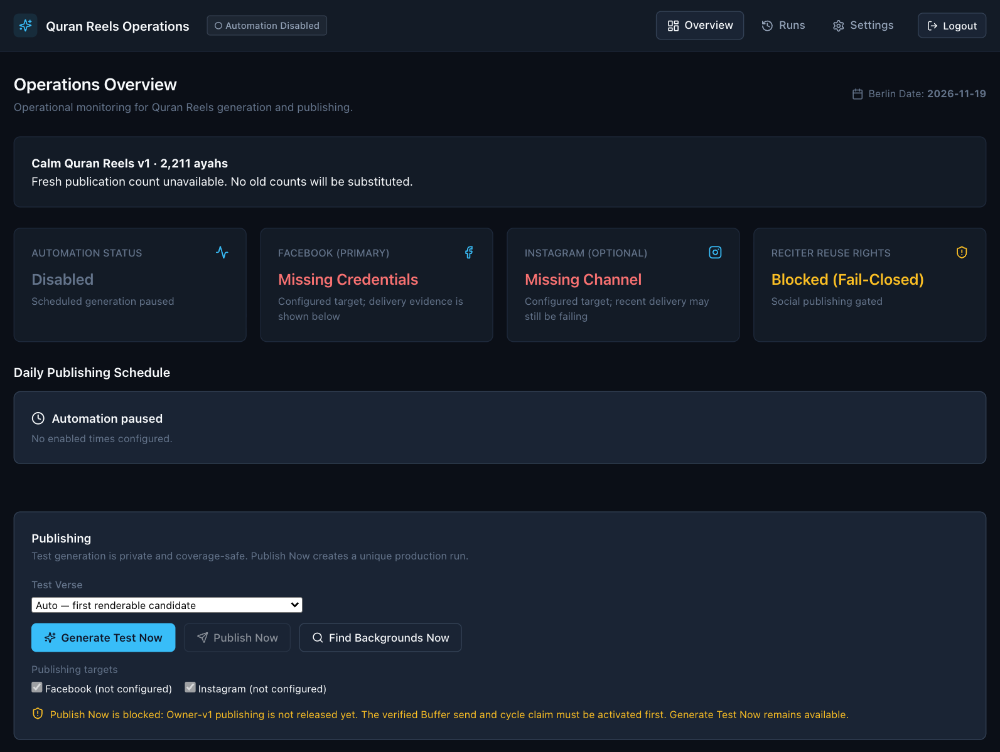

# Quran Reels Automation

Create vertical Quran recitation videos with Arabic text, English or German subtitles (or both), and screened nature footage. Preview the layout on your computer or connect your own accounts to publish through Buffer.

**[Try the local preview](#try-the-subtitle-preview)** · **[Set up your own installation](#run-it-with-your-own-accounts)**

<a id="get-the-code"></a>

## Try the subtitle preview

Install **Node.js 22** with npm. From a terminal with Git, run:

```sh
git clone https://github.com/haiderhamad/quran-reels-automation.git
cd quran-reels-automation/apps/dashboard
npm ci
npm run dev
```

Open [the subtitle preview](http://127.0.0.1:3000/preview-qa#reel-preview). It shows complete ayahs from the approved catalog. Choose **3 Lines** to see how a longer ayah fits. You can try this without an account, database or API keys.

<details>
<summary>Using a ZIP or a different port?</summary>

On GitHub choose **Code → Download ZIP**, extract it and open a terminal in `apps/dashboard`. Run `npm ci` and `npm run dev`. If the terminal shows a port other than 3000, open that port with the same `/preview-qa#reel-preview` path. Press **Ctrl+C** to stop the preview.

</details>

## Run it with your own accounts

1. [Create a private installation](docs/PUBLIC_SETUP.md#create-the-private-installation) and [set up your admin login](DEPLOYMENT.md#create-your-first-admin-login). Connect an [empty Supabase database](DEPLOYMENT.md#fresh-database) and save your settings with automation off.
2. [Connect the source and storage accounts](docs/PUBLIC_SETUP.md#accounts-and-opt-ins), then [qualify a background clip](docs/PUBLIC_SETUP.md#build-a-background-pool).
3. [Generate your first private MP4](docs/PUBLIC_SETUP.md#from-the-first-mp4-to-buffer) with `run_kind=test`. Open the video in your B2 bucket and check the audio and subtitles.
4. When you have reuse permission and want to publish, follow the **Buffer** steps in the same walkthrough. Verify Facebook and Instagram separately before [enabling the schedule](DEPLOYMENT.md#scheduler).

## How a Reel gets made

<picture>
  <source media="(prefers-reduced-motion: reduce)" srcset="docs/diagrams/quran-reels-architecture.svg">
  
</picture>

Follow the solid arrows to the private MP4 in Backblaze B2. The dashed amber route continues through Buffer when publishing is enabled.

[Open the interactive architecture map](docs/diagrams/reel-workflow-animated.html) · [Full-size still diagram](docs/diagrams/quran-reels-architecture.svg) · [Architecture details](ARCHITECTURE.md)

After cloning, open `docs/diagrams/reel-workflow-animated.html` in a browser to explore generation, delivery and background screening. Use the **Still / Live** control to toggle motion.

## Inside the dashboard

**Overview** shows the schedule, channel status and controls for testing or publishing. This example shows a fresh installation with accounts disconnected.

[](docs/images/dashboard-overview.webp)

**Settings → Subtitle & Visual Style** controls languages, type size and spacing. English allows up to three lines per panel, or a lower limit you select. German allows up to four. The preview and Worker use these limits and the Worker also checks available screen space.

[](docs/images/dashboard-subtitle-settings.webp)

<details>
<summary>See the preview on a phone</summary>


</details>

## Run the developer checks

Install Python 3.12, Fontconfig, libass and an FFmpeg build with libass subtitle support. Run these commands from the repository root on macOS or Linux. The CV fetch downloads three pinned OpenCV models for background screening.

```sh
python3.12 -m venv .venv
. .venv/bin/activate
python -m pip install -r requirements.txt
python scripts/fetch_fonts.py --offline
python scripts/fetch_cv_models.py
python scripts/run_python_tests.py --fail-on-skip
python scripts/check_repository_safety.py
```

From `apps/dashboard`, run `npm ci`, `npm test` and `npm run build` to check the web app.

Use the [local panel review guide](docs/PUBLIC_SETUP.md#review-a-proposal-or-render-the-approved-panels-locally) to review Al-Baqarah 2:20 or 2:25 on your computer.

## License and contributions

Eligible original software is distributed under the [Apache License 2.0](LICENSE). The bundled fonts and attributed editorial selection carry their own terms. [Third-party notices](THIRD_PARTY_NOTICES.md) · [Contributing](CONTRIBUTING.md) · [Security reporting](SECURITY.md)
