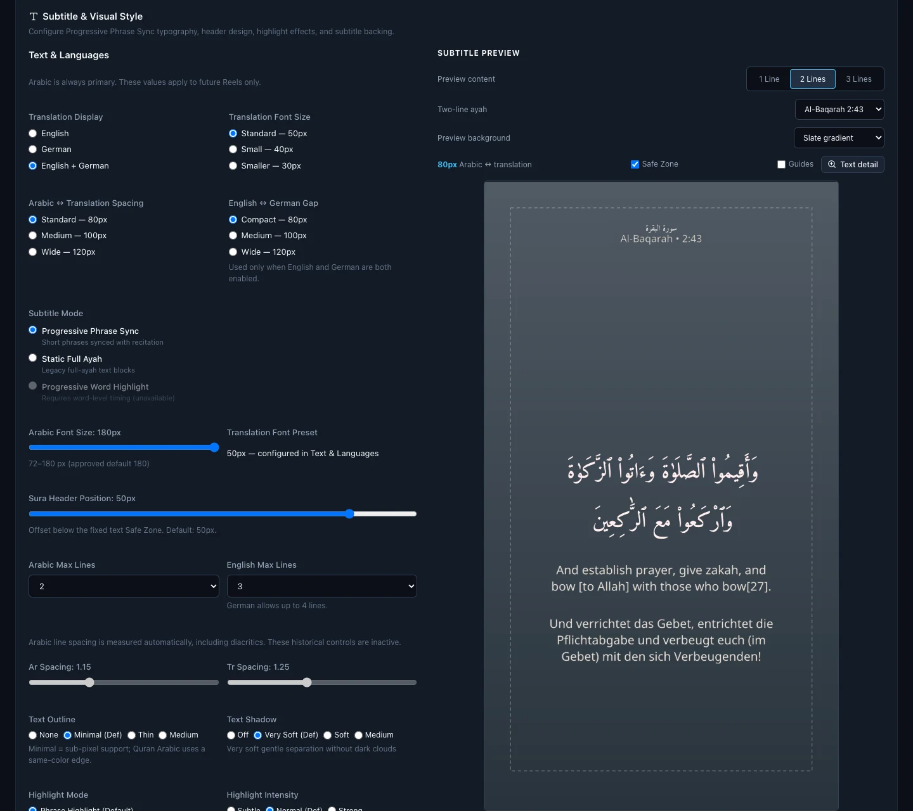
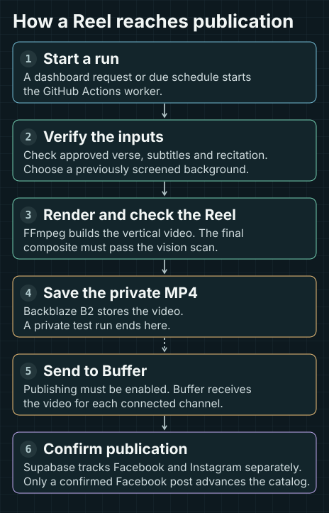

# Quran Reels Automation

Create a vertical Quran recitation video with Arabic text, English and German Rowwad subtitles, and screened nature footage. Run your own Next.js dashboard to review settings and run history. A Python worker renders a 1080 × 1920 MP4 with FFmpeg and can send it to your Facebook and Instagram channels through Buffer.

| Start here | What you need | What you get |
| --- | --- | --- |
| [Try the subtitle preview](#try-the-subtitle-preview) | Node.js 22 and npm | An interactive preview in your browser. No accounts required. |
| [Verify Al-Baqarah 2:35](#verify-al-baqarah-235) | Python 3.12, native subtitle tools and internet access | A report showing how the Arabic, English and German fit the recitation. No accounts required. |
| [Run it with your own accounts](#run-it-with-your-own-accounts) | Your own private GitHub repository and provider accounts | A private MP4 to review, then optional publishing through Buffer. |

[See the dashboard](#inside-the-dashboard) · [Follow one Reel from start to finish](#how-a-reel-gets-made)

## Get the code

Open a terminal and run:

```sh
git clone https://github.com/haiderhamad/quran-reels-automation.git
cd quran-reels-automation
```

You can also choose **Code → Download ZIP** on GitHub. Extract the ZIP and open a terminal in the folder containing `apps/` and `requirements.txt`. This is the **repository root** used below.

## Try the subtitle preview

From the repository root, start the dashboard:

```sh
cd apps/dashboard
npm ci
npm run dev
```

Open [the subtitle preview](http://127.0.0.1:3000/preview-qa#reel-preview). If the terminal shows a different port, use that port with the same path. Under **Preview content**, choose **3 Lines**. The studio sample stays visible and a warning appears below the frame when it exceeds the default two-line limit. You can change the controls without signing in.

When finished, press **Ctrl+C** in the terminal and run `cd ../..` to return to the repository root.

<details>
<summary>See the preview on a phone</summary>


</details>

## Inside the dashboard

After you [create an admin login](DEPLOYMENT.md#create-your-first-admin-login), open **Overview** to check whether automation is on, see the daily schedule and inspect each channel. **Generate Test Now** requests a private Reel. **Publish Now** requests delivery when the publishing checks pass. The screenshot shows a fresh local installation with its accounts disconnected.

[](docs/images/dashboard-overview.webp)

Open **Settings → Subtitle & Visual Style** to choose English, German or both alongside Arabic. Adjust type size and spacing and check the sample in the vertical preview. The screenshot shows **English + German** selected.

[](docs/images/dashboard-subtitle-settings.webp)

Elsewhere in **Settings** you can set daily publishing times, generation limits and social destinations, and check recitation reuse and connection health. Open **Runs** to inspect individual generation and delivery results.

## Verify Al-Baqarah 2:35

To try a real ayah, install Python 3.12, Fontconfig, the native libass library and an FFmpeg build with libass subtitle support. The verifier downloads the public sources into a fresh temporary cache. You can skip the background-screening models for this check.

From the repository root on macOS or Linux:

```sh
python3.12 -m venv .venv
. .venv/bin/activate
python -m pip install -r requirements.txt
python -m scripts.verify_public_bilingual_235
```

Look for `VERIFIED_PHRASE_PROGRESSIVE` in the JSON report, English Rowwad **1.0.19** and German Rowwad **1.0.15**. The three panels cover 0–6.338, 6.338–10.864 and 10.864–18.560 seconds from the start of the ayah. To create an MP4, continue with the private setup below.

## Run it with your own accounts

| Step | What to do | How to check it |
| --- | --- | --- |
| 1. Create your installation | [Import the source into a private GitHub repository](docs/PUBLIC_SETUP.md#create-the-private-installation) and [create your admin login](DEPLOYMENT.md#create-your-first-admin-login). | Sign in to the dashboard. |
| 2. Connect the database | [Initialize an empty Supabase database](DEPLOYMENT.md#fresh-database). Configure the dashboard host and the private repository's [Actions secrets and variables](docs/PUBLIC_SETUP.md#accounts-and-opt-ins) separately. | Save and reload dashboard settings with automation off. |
| 3. Prepare sources and footage | Configure Quran Foundation, private B2 storage and your footage providers. Check the [pinned editions and reuse terms](docs/PUBLIC_SETUP.md#english-rowwad-1019). [Discover and qualify backgrounds](docs/PUBLIC_SETUP.md#build-a-background-pool) on GitHub Actions or locally on a Mac. | At least one screened background is eligible for use. |
| 4. Render a private MP4 | Follow the [first MP4 walkthrough](docs/PUBLIC_SETUP.md#from-the-first-mp4-to-buffer). On your private default branch, enable the Worker with `QURAN_REELS_PRODUCTION_ENABLED=true`, keep publishing off and select **Generate Reel → Run workflow → run_kind=test**. | Open the MP4 in your B2 bucket and check the text, timing and audio. Both channels should say `NOT_ATTEMPTED`. |
| 5. Publish when ready | Confirm reuse permission, run **Buffer Readiness Check**, then follow the [manual publishing walkthrough](docs/PUBLIC_SETUP.md#from-the-first-mp4-to-buffer). | Verify Facebook and Instagram individually before enabling the [scheduler](DEPLOYMENT.md#scheduler). Only a confirmed Facebook receipt advances the catalog of 2,211 ayahs. |

## How a Reel gets made



[View the full-size diagram](docs/diagrams/quran-reels-architecture.svg) · [Offline HTML diagram with a text walkthrough](docs/diagrams/quran-reels-architecture.html) · [Architecture details](ARCHITECTURE.md)

A private test ends at the stored MP4 (step 4). For a publishing run, follow steps 5 and 6 to see what happened on each channel. To read the walkthrough offline, open the HTML file in your browser.

## Run the developer checks

Start in the repository root with the Python environment from [the 2:35 check](#verify-al-baqarah-235) active. The CV fetch downloads three pinned OpenCV models for background screening.

```sh
python scripts/fetch_fonts.py --offline
python scripts/fetch_cv_models.py
python scripts/run_python_tests.py --fail-on-skip
python scripts/check_repository_safety.py
```

From `apps/dashboard`, run `npm ci`, `npm test` and `npm run build` to check the web app.

## License and contributions

Eligible original software is distributed under the [Apache License 2.0](LICENSE). The bundled fonts and attributed editorial selection carry their own terms. [Third-party notices](THIRD_PARTY_NOTICES.md) · [Contributing](CONTRIBUTING.md) · [Security reporting](SECURITY.md)
